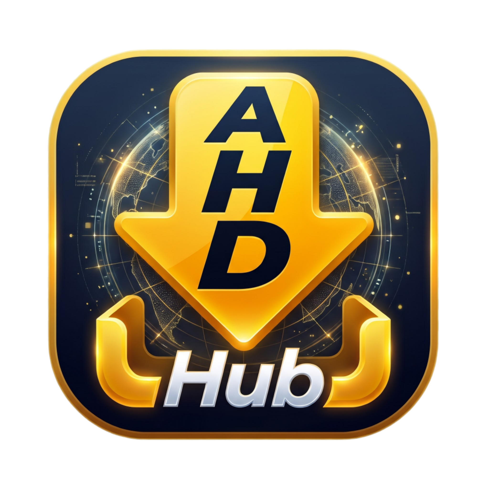
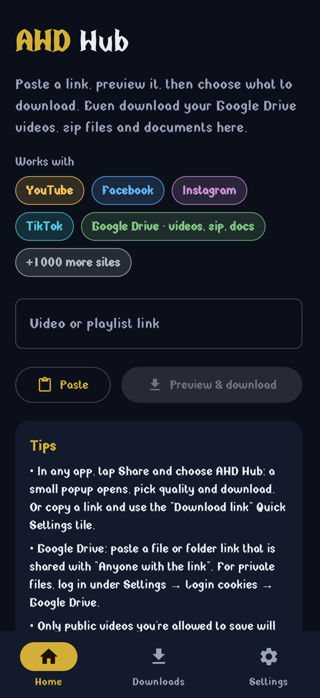
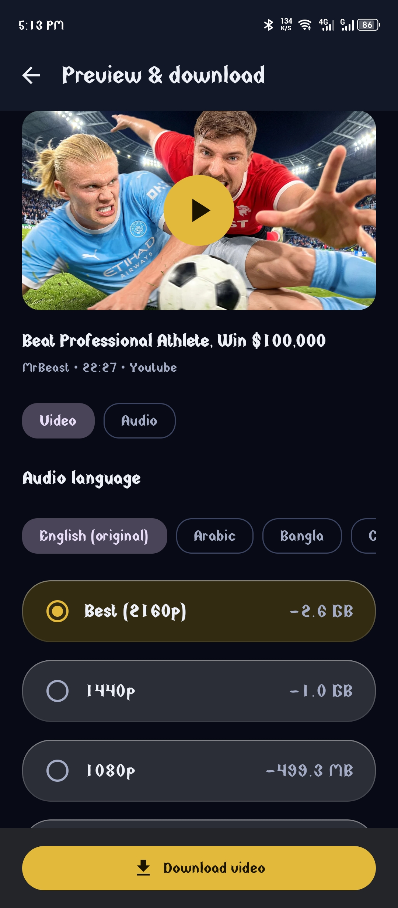
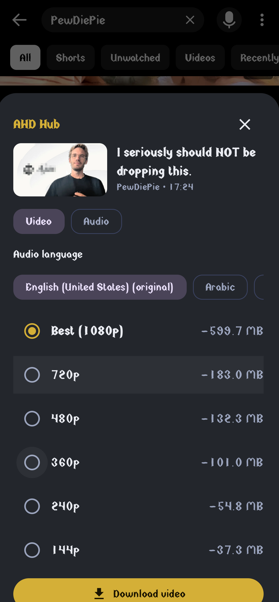
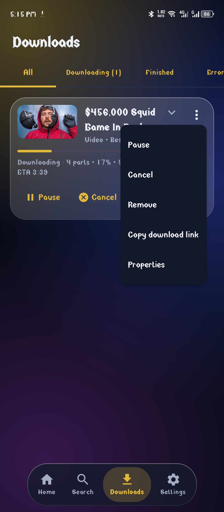
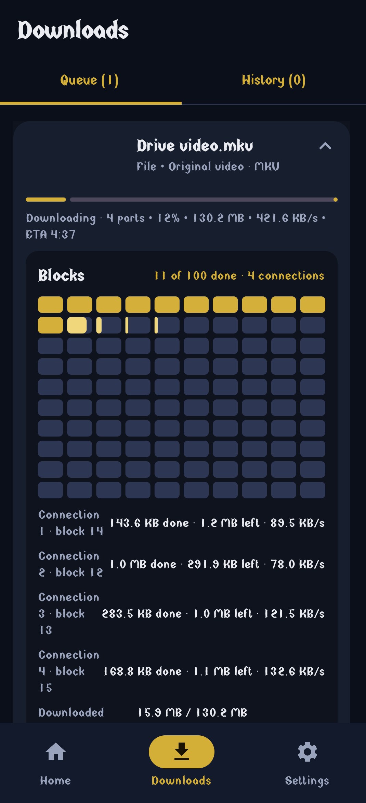
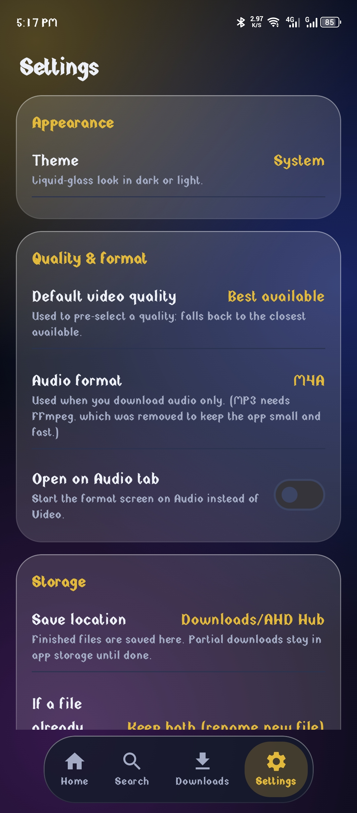

  

<h1 align="center">AHD Hub</h1>

<b>AHVEN Download Hub</b> – a free, open-source video and file downloader for Android. 
Made by AH · <a href="mailto:ahvenstudio@gmail.com">ahvenstudio@gmail.com</a>

  <a href="../../releases/latest"><b>⬇ Download the latest APK</b></a>

---

## What it does

Paste or share a link, see the available qualities with an estimated size, and download in the background. It is powered by [yt-dlp](https://github.com/yt-dlp/yt-dlp), so it works with YouTube, Facebook, Instagram, TikTok, Google Drive and 1000+ other sites.

## Screenshots

| Home | Choose quality | Share popup |
|:---:|:---:|:---:|
|  |  |  |

| Downloads | Google Drive (blocks) | Settings |
|:---:|:---:|:---:|
|  |  |  |

## Features

**Downloading**
- Video quality choice with an estimated file size (MP4 or MKV), or audio only (MP3 / M4A)
- Choose the audio language of videos that have several audio tracks
- Playlists: pick the videos you want, see the estimated total size
- Share any link from another app: a small popup opens, pick the quality, and it downloads in the background
- Paste button, and automatic reading of a copied link when the app opens (can be turned off)
- Pause, resume, retry, open the finished file with any app
- Wi-Fi only option, 1–5 downloads at the same time, choice of what to do when a file already exists
- Adjustable **number of parts** (1–16) for faster downloads

**Google Drive**
- Videos, zip files, documents and any other shared file, downloaded in several parts at once with a block-by-block view
- Google Docs, Sheets and Slides with a choice of format (PDF, DOCX, XLSX, PPTX, CSV, TXT)
- Optional Google login (cookies) for files that need it

**Organised storage**
- Files are sorted into folders by type inside the folder you choose: Videos, Music, Photos, Documents, Compressed, Programs, Subtitles, Torrents, Others

**Notifications**
- Progress notification with the video name, thumbnail, percentage, speed, size and time left

**Updates**
- Built-in app updates (checked from GitHub Releases). A new version can be postponed for at most 2 days, then the update is required
- One-tap update of the download engine (yt-dlp) in Settings

## Install

1. Open the [Releases page](../../releases/latest).
2. Download one APK:
   - **arm64-v8a** – most phones from the last several years
   - **armeabi-v7a** – old 32-bit phones
   - **universal** – works on both, bigger file
3. Open it and allow "install unknown apps" when Android asks.

Requires Android 8.0 (API 26) or newer.

## Tips

- If YouTube shows an error, open **Settings → Update engine** first. If it still fails, try the *Nightly* update channel or log in under **Login cookies**.
- Google Drive may block a file that was downloaded too many times (quota). Try later or lower the number of parts.
- Files protected with DRM cannot be downloaded.

## Built with

Kotlin · Jetpack Compose · Room · DataStore · Coil · Media3 · Coroutines · [yt-dlp](https://github.com/yt-dlp/yt-dlp) · FFmpeg · [youtubedl-android](https://github.com/yausername/youtubedl-android)

## Legal

AHD Hub is released under the **GNU GPL v3** (see `LICENSE`). Download only content you own or have permission to save. You are responsible for following the terms of the sites you use and your local laws. This project is not affiliated with YouTube, Google, Meta, TikTok or any other service.
