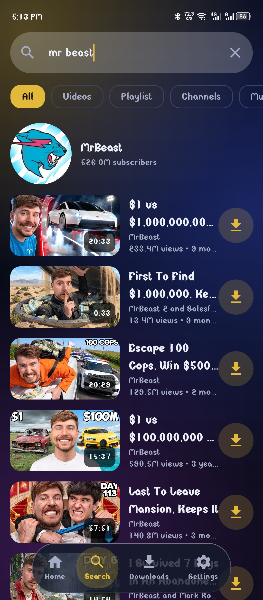
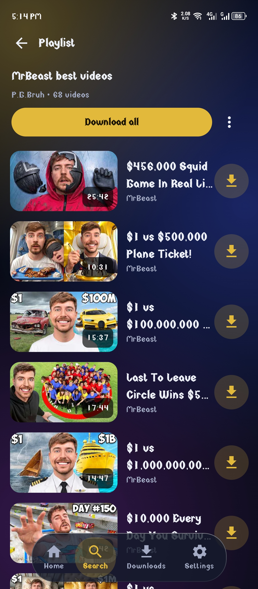
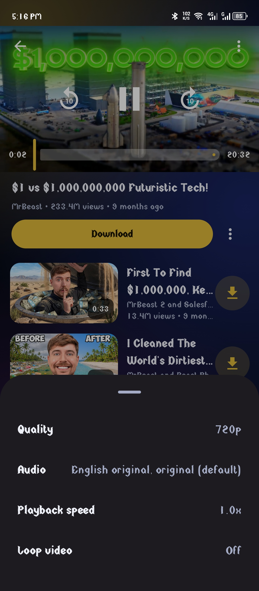
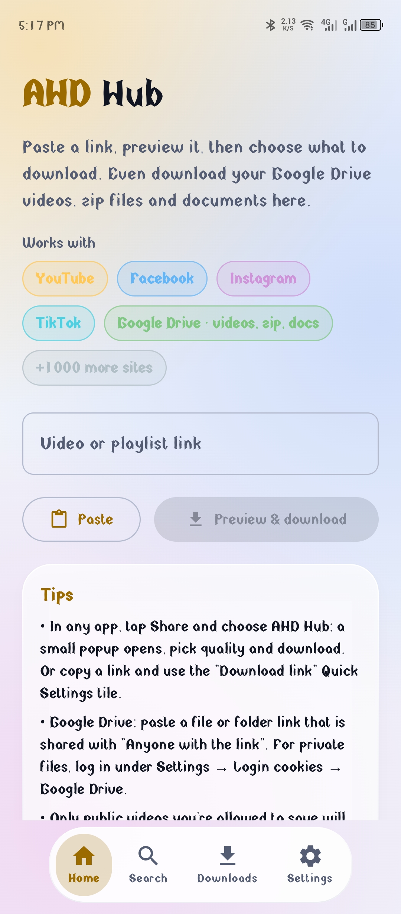

# AHD Hub

**AHVEN Download Hub: a fast, modern, open-source downloader for Android.**
Paste a link or search YouTube, pick the quality, and download. Videos, music, playlists and plain files.

  
  
  
  

[**Download the APK**](../../releases/latest) · [Features](#-features) · [Screenshots](#-screenshots) · [Credits](#-credits)

---

## ✨ Features

|  |  |
| :-- | :-- |
| 🔎 **Search tab** | Search YouTube right inside the app: **All · Videos · Playlists · Channels · Music**. Every result has its own download button, and playlists show a clear playlist badge with the video count. |
| ▶️ **Built-in player** | Watch before you download. Picture and sound are merged on the fly, with **quality** and **audio-language** choice, playback speed and loop. Controls float over the video, no solid black bars. |
| ⚡ **Fast fetch** | Link info comes from the NewPipe extractor first, so the quality list appears in a moment. yt-dlp is the fallback for the many other supported sites. |
| 🎞️ **Choose exactly what you get** | Pick the resolution, the audio track (multi-audio videos too), subtitles, or audio only. |
| 📃 **Playlists** | Download a whole playlist or tick only the videos you want. |
| 🚀 **Multi-connection downloads** | Up to 16 parallel parts, pause, resume and retry. Files in the app's own folder (`Downloads/AHD Hub`). |
| 🗂️ **Downloads manager** | **All · Downloading · Finished · Error** tabs. A ⋮ menu on every item: Play, Open, Share, Open folder, Redownload, Copy link, Copy / Move / Rename, Properties, Remove. |
| 🎵 **Play downloads in the app** | Finished videos and music open in the same player. |
| 🔒 **DNS over HTTPS** | Optional DoH for the app's own lookups (Cloudflare, Google, Quad9 or your own server). |
| 🌗 **Liquid-glass design** | Modern glass-style interface with **dark and light** themes and a floating tab bar. |
| 🔄 **In-app updates** | Update from the app itself. Releases go through a test (pre-release) step before they reach everyone. |
| 🪶 **Small** | arm64-v8a only, R8-shrunk. No ads, no trackers, no analytics. |

> The app does not download DRM-protected streams and does not bypass any site's protection.

## 📸 Screenshots

| Home | Pick quality | Search |
| :---: | :---: | :---: |
|  |  |  |

| Playlist results | Player | Downloads |
| :---: | :---: | :---: |
|  |  |  |

| Settings | Light theme |
| :---: | :---: |
|  |  |

## 📥 Install

1. Open the [latest release](../../releases/latest) and download the `.apk`.
2. Allow "install unknown apps" for your browser or file manager when Android asks.
3. Open **AHD Hub**. Later updates arrive from inside the app (Settings → App update).

**Requirements:** Android 8.0 (API 26) or newer, 64-bit ARM phone (arm64-v8a).

## 🧭 How to use

- **Home:** paste a link (or share a link to the app), choose the quality, tap download.
- **Search:** type a name, pick a filter, tap a result to watch it, or tap its download icon to pick the quality straight away.
- **Downloads:** follow progress, pause or resume, and play or share finished files.
- **Settings:** theme, download folder, connections, DNS over HTTPS, cookies, cache, app update.

## 🧱 Built with

Kotlin · Jetpack Compose · Room · DataStore · Media3 ExoPlayer · OkHttp · Coil

## 🙏 Credits

AHD Hub stands on the shoulders of great open-source work:

- [NewPipe Extractor](https://github.com/TeamNewPipe/NewPipeExtractor): fast YouTube info, search and playlists
- [yt-dlp](https://github.com/yt-dlp/yt-dlp) and [youtubedl-android](https://github.com/yausername/youtubedl-android): wide site support
- [OkHttp](https://github.com/square/okhttp), [Coil](https://github.com/coil-kt/coil), [Media3](https://github.com/androidx/media)

## ⚖️ License and notice

AHD Hub is free software under the **GNU GPL v3.0**, see [LICENSE](LICENSE).
Download only content you have the right to save. You are responsible for how you use the app and for following the terms of the sites you use. This project is not affiliated with YouTube, Google or any other service.

Made with ♥ by **AH** · Star ⭐ the repo if it helps you

